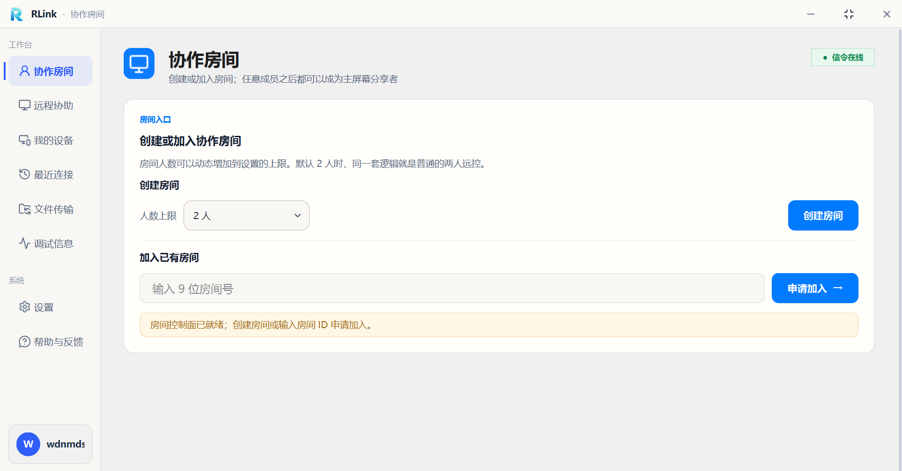
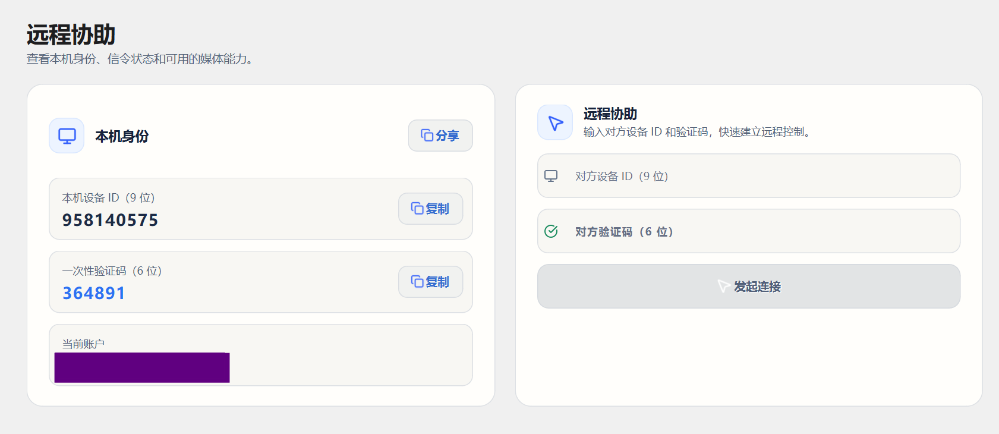
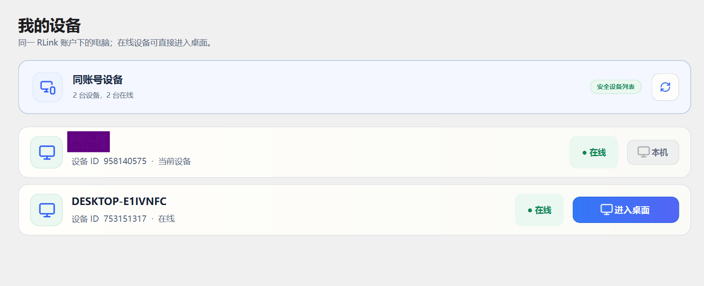
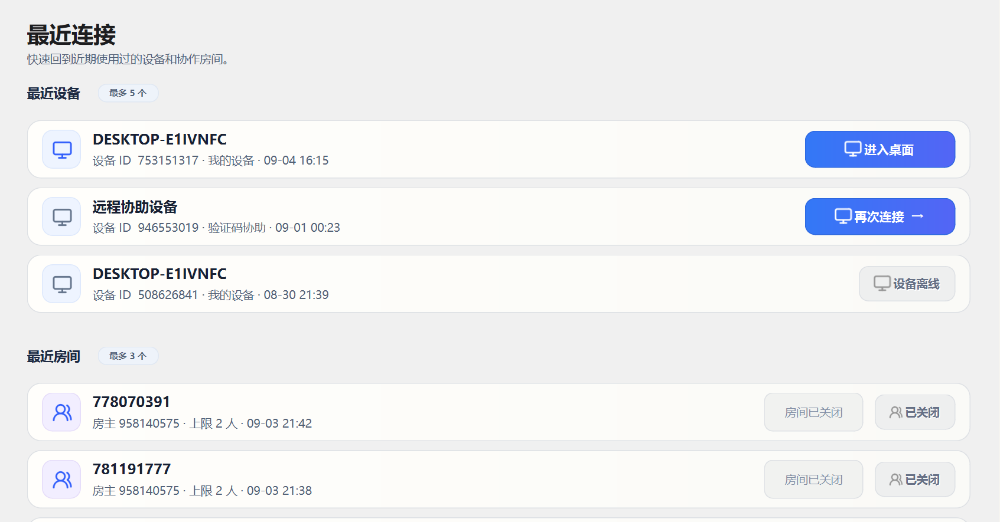
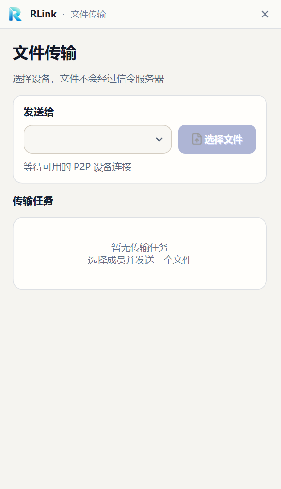
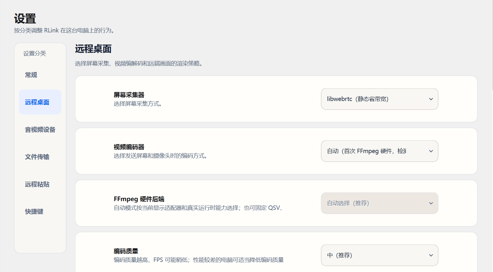

<h1 align="center">
   RLink
</h1>

<p align="center">简体中文 · <a href="README.en.md">English</a></p>

<p align="center">连接你的电脑，一起协作。</p>

<p align="center">
  Windows 原生远程桌面 · 验证码远程协助 · 多人音视频与屏幕共享
</p>

<!-- 下载按钮固定到对应 Release。发布新版本时同步更新版本与资产名；不要拼接 latest 与含旧版本号的文件名。 -->
<p align="center">
  <a href="https://github.com/dyhwdnmd/RLink-RemoteCtrl/releases/download/v0.1.13/RLink-Setup-0.1.13.exe"></a>
  <a href="https://github.com/dyhwdnmd/RLink-RemoteCtrl/releases/download/v0.1.13/RLink-Portable-Windows-x64-0.1.13.zip"></a>
</p>

<p align="center">
  <a href="#下载">下载与使用</a> ·
  <a href="#功能">功能介绍</a> ·
  <a href="#功能界面">界面预览</a> ·
  <a href="#构建">源码构建</a> ·
  <a href="https://github.com/dyhwdnmd/RLink-RemoteCtrl/releases">版本记录</a>
</p>

---

RLink 是一款面向 Windows 的高性能开源远程桌面与多人协作工具，支持最高 4K、120 FPS 的低延迟桌面共享。用户可通过设备 ID 和一次性验证码快速发起远程协助，也可登录账户直接访问自己的在线设备，并支持多人音视频、屏幕共享、远程控制。

## 下载

当前下载入口对应 **v0.1.13**。普通用户直接下载安装包，无需准备 Qt、WebRTC 或编译环境。

| 版本 | 下载 | 使用方式 |
| --- | --- | --- |
| Windows x64 安装版（推荐） | [下载安装程序](https://github.com/dyhwdnmd/RLink-RemoteCtrl/releases/download/v0.1.13/RLink-Setup-0.1.13.exe) | 双击安装，适合长期使用与后续软件更新 |
| Windows x64 便携版 | [下载 ZIP](https://github.com/dyhwdnmd/RLink-RemoteCtrl/releases/download/v0.1.13/RLink-Portable-Windows-x64-0.1.13.zip) | 完整解压后运行 `RLinkAPP.exe`，适合临时使用与测试 |

[查看最新发布与其他版本](https://github.com/dyhwdnmd/RLink-RemoteCtrl/releases) ·
[安装包 SHA-256](https://github.com/dyhwdnmd/RLink-RemoteCtrl/releases/download/v0.1.13/RLink-Setup-0.1.13.exe.sha256.txt) ·
[便携包 SHA-256](https://github.com/dyhwdnmd/RLink-RemoteCtrl/releases/download/v0.1.13/RLink-Portable-Windows-x64-0.1.13.zip.sha256.txt)

安装版和便携版都包含运行所需资源。便携版请保留解压后的 DLL、插件及其他文件，不要单独移动 EXE。
Release 中的 `RLink-Windows-x64-0.1.13.zip` 供已安装客户端自动更新使用，不是便携包。`Source code` 是源码压缩包，`RLink-update.json` 是客户端更新清单，都不是安装程序。

### 开始使用

1. 在需要连接的 Windows 电脑上安装或解压 RLink，并登录账户。
2. 按使用场景选择入口：
   - **远程协助**：对方提供 9 位设备 ID 和 6 位一次性验证码，你输入后发起连接。
   - **我的设备**：两台电脑登录同一账户，从在线设备列表直接进入远程桌面。
   - **协作房间**：创建或加入房间，开启语音、摄像头或屏幕共享，需要操作时向分享者申请控制。

远程连接使用 WebRTC P2P 通道，连通性取决于两端网络。无法建立连接时，检查防火墙是否允许 RLink 联网，
也可更换网络或使用手机热点重试。画面分辨率与帧率取决于采集端硬件、编码器、网络带宽和接收端解码能力。

## 功能

以下是当前源码提供的功能；已发布安装包的具体变更见对应 Release 说明。

### 远程桌面

- [x] AI 场景自适应
  - 根据代码、文档、表格、视频、游戏等画面场景，自动调整网络波动时清晰度与流畅度的取舍，场景切换平滑过渡
  - 需手动开启并配置 AI 模型 API，本地模型开发中
- [x] Windows 电脑之间的远程观看与键鼠控制
  - 键盘输入、鼠标移动、点击、滚轮和拖动
  - 远端光标位置与形状同步
- [x] 高清画面与帧率选择
  - 支持 4K 画面，最高 120 FPS 目标帧率
  - 15 / 24 / 30 / 45 / 60 / 80 / 100 / 120 FPS 档位，按当前采集能力和房间人数显示可用选项
  - 720p / 1080p / 1440p / 原始画质，按源显示器分辨率调整可用档位
- [x] 多显示器列表与共享屏幕切换
- [x] 窗口、最大化与全屏观看
- [x] 适应窗口（保持比例）与 100% 原始像素模式，支持拖动画面查看细节
- [x] 桌面采集、硬件/软件编解码与画面渲染方式选择

### 连接与设备管理

- [x] 设备 ID + 一次性验证码远程协助，成功协助后自动更新验证码
- [x] 同账户设备列表、在线状态与免验证码直连
- [x] 最近设备和房间记录，显示连接方式与最近使用时间
- [x] 网络中断时保留最后画面、暂停输入，并自动尝试恢复会话

### 多人协作与音视频

- [x] 创建或加入最多 5 人的协作房间
- [x] 多人语音、摄像头会议与屏幕共享
- [x] 共享屏幕接替与远程控制申请
- [x] 分享者批准、拒绝和收回控制权，支持只观看模式
- [x] 摄像头画廊与独立摄像头观看窗口
- [x] 摄像头、麦克风与扬声器选择，支持开启、关闭、静音和设备切换

### 文件传输与复制粘贴

- [x] 通过已连接设备的 P2P 通道传输文件，不经过信令服务器
  - 接收、另存为或拒绝文件
  - 进度查看、暂停、继续、取消与完整性校验
  - 打开接收目录
- [x] 双向远程复制粘贴文本和文件
- [x] 粘贴内容类型与单次文件大小限制
- [x] 粘贴缓存位置、保留时间、容量设置与手动清理

### 外观与日常使用

- [x] 浅色、深色与跟随系统主题
- [x] 界面动画、字体与字号设置
- [x] 开机启动、启动后的窗口状态与关闭按钮行为设置
- [x] 常用快捷键说明
- [x] 自动及手动检查软件更新，展示版本、摘要和更新内容
  - CNB 更新源与 GitHub 兜底，下载或校验失败时切换镜像
  - 低于最低支持版本时提示强制更新

### 诊断与自建服务

- [x] 连接、网络路径与恢复状态查看
- [x] 发送/接收帧率、码率、延迟与设备能力诊断
- [x] 文件、剪贴板和输入控制状态查看
- [x] 客户端与 C++ 信令服务器源码，支持自行构建与部署

### 平台支持

| 平台 | 状态 |
| --- | --- |
| Windows x64 | 已提供客户端 |
| Linux | TODO |
| Android | TODO |
| macOS | TODO |

TODO 表示尚未提供客户端。

## 功能界面

### 协作房间

创建或加入多人协作房间，房间成员可以申请观看、控制并接替主屏幕共享。



### 远程协助

被控端提供 9 位设备 ID 和一次性验证码，控制端输入后即可发起临时远程协助。



### 我的设备

同一 RLink 账户下的在线设备会自动显示，可从设备列表直接进入远程桌面。



### 最近连接

保留近期使用过的设备和协作房间，区分我的设备、验证码协助以及在线状态。



### 文件传输

文件通过已建立的 P2P 通道直接传输，不经过信令服务器。

<p align="center">
  
</p>

### 远程桌面设置

可以选择屏幕采集器、视频编码器、硬件编码后端和编码质量等远控参数。



## 技术与自建服务

RLink 使用 **C++20、Qt 6、libwebrtc 和 FFmpeg**：Qt 提供原生桌面界面与 WSS 信令客户端，
libwebrtc 承载音视频、DataChannel、拥塞控制与连接恢复；Windows 采集、编解码和渲染结合
**Direct3D 11、DXGI 与 Media Foundation**。账户登录与身份认证使用 **Logto**。

仓库包含可独立部署的信令服务器源码。自行部署时，需要准备可达的信令地址、TLS 证书及相应认证配置；
生产账户登录需要配置 Logto。密钥、令牌和本机部署配置不属于公开源码，不能提交到仓库。

## 构建

要求 CMake 3.24+、Visual Studio 2022（v143 工具集）、Windows SDK、
Qt 6.11.x（MSVC 2022 x64）以及使用 `/MD` 构建的 WebRTC。

依赖路径通过环境变量 `RLINK_QT_DIR`、`RLINK_WEBRTC_SRC`、
`RLINK_WEBRTC_OUT` 提供；也可复制 `cmake\local.bat.example` 为
`cmake\local.bat` 并填写本机路径。该文件已忽略，不要在其中保存
信令令牌、证书私钥或其他凭证。

第一次在全新 Windows 环境构建时，请先阅读
[Windows 源码构建指南](Windows源码构建指南.md)。其中包含 Qt 组件、
固定 libwebrtc commit、GN 参数、依赖产物检查和常见链接错误处理。
English readers can use [Building RLink on Windows](BUILDING.md).

```powershell
.\cmake_configure.bat
cmake --build --preset windows-msvc-x64-v143-release -j
```

也可直接用 CMake 预设：`cmake --preset windows-msvc-x64-v143` 后
`cmake --build --preset windows-msvc-x64-v143-release -j`。

要在 Visual Studio 中阅读或编译，先完成上面的 configure，再打开
`build\RLinkRemoteCtrl.sln`。`build\RLink.sln` 和 `ControllerApp.vcxproj`
属于旧构建产物，不是当前入口。

Debug 构建使用 `cmake --build --preset windows-msvc-x64-v143-debug -j`，
需要先按构建指南准备 Debug 版 WebRTC。

主要产物位于 `x64\Release`：

- `RLinkAPP.exe`：RLink 客户端，控制端与采集端共用。
- `RLinkUpdater.exe`：独立软件更新器，由客户端在确认更新后启动。
- `RemoteCSignalServer.exe`：RLink 的 WSS 信令服务。

公开仓库提供源码编译、自建信令服务和 FFmpeg 依赖构建所需内容。
安装包制作、正式版本签名与 GitHub/CNB Release 发布流程由项目维护者在本地完成，
不属于公开源码构建步骤。

桌面采集和硬件编解码依赖当前 Windows 会话、显示器和驱动，最终发布
前仍需进行双机冒烟：建房/入房、共享/接替、控制与 ReleaseAll、
30/60/120 FPS、两种采集器、文件、摄像头/麦克风和 ICE Restart。

## 仓库结构

- 仓库根目录：构建入口 `CMakeLists.txt`、`CMakePresets.json`、`cmake_configure.bat` 和使用说明。
- `cmake`：依赖配置、目标定义与本机构建配置模板。
- `src`：RLink 客户端、服务端以及各功能模块源码。
- `assets`：图标、SVG、主题、字体和 Windows 资源。
- `third_party`：随项目构建或运行的第三方依赖。
- `scripts`：FFmpeg 依赖构建、公开信令服务部署与启动辅助脚本。
- `tools`：源码导航和公开资源的维护工具。

## 从哪里开始读

需要按文件查找类、成员变量和函数时，使用
[源码导航](源码导航/README.md)。索引覆盖 `src` 下全部
C/C++ 文件，并提供可点击源码行号和自动更新脚本。

## 问题反馈

欢迎通过 [GitHub Issues](https://github.com/dyhwdnmd/RLink-RemoteCtrl/issues) 反馈问题或提出建议。
说明客户端版本、Windows 版本、连接方式、复现步骤，并附上相关诊断信息。
提交截图或日志前，请隐去邮箱、设备 ID、一次性验证码、访问令牌及其他敏感信息。

## 许可证

RLink 自有源码采用 [GNU GPL v3.0](LICENSE) 许可证，版权所有
`Copyright (c) 2026 dyhwdnmd`。修改和再发布 RLink 时，需要按照 GPL-3.0
提供对应源码并保留许可证与版权声明。

RLink 使用的第三方组件仍分别遵循其原始许可证，详见
[第三方软件与许可证](THIRD_PARTY_NOTICES.md)。其中 WebRTC 使用 BSD
3-Clause 风格许可证；当前随项目提供的 FFmpeg/libx264 运行时启用了 GPL
组件，按 GPL v2 或更高版本提供，本项目选择与 GPL-3.0 兼容的分发方式。
